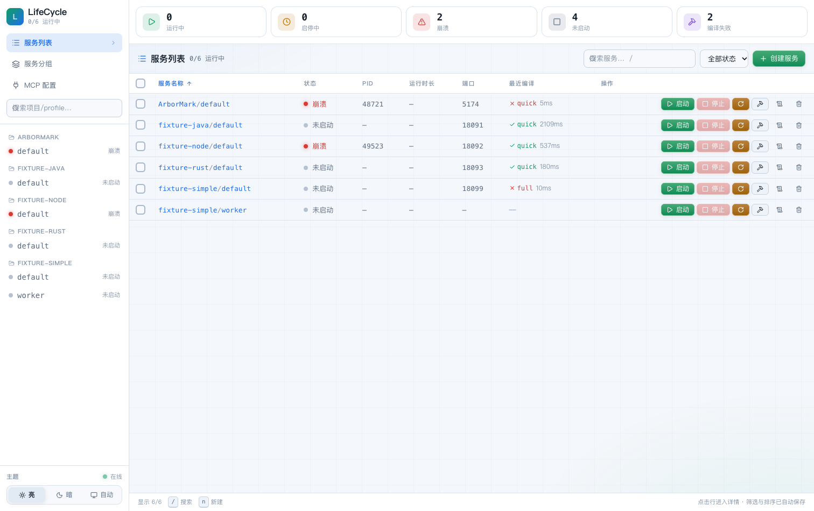
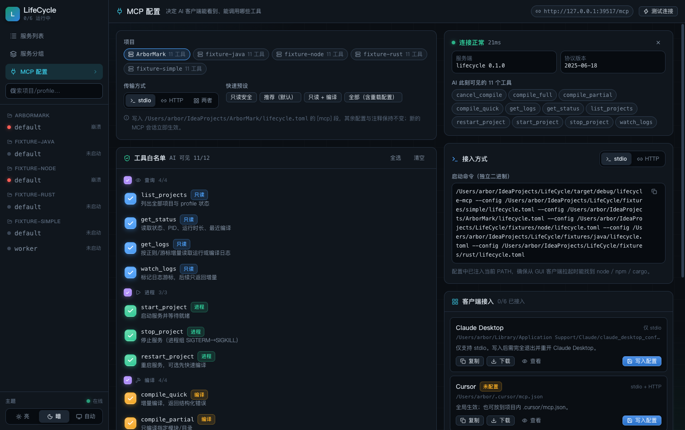
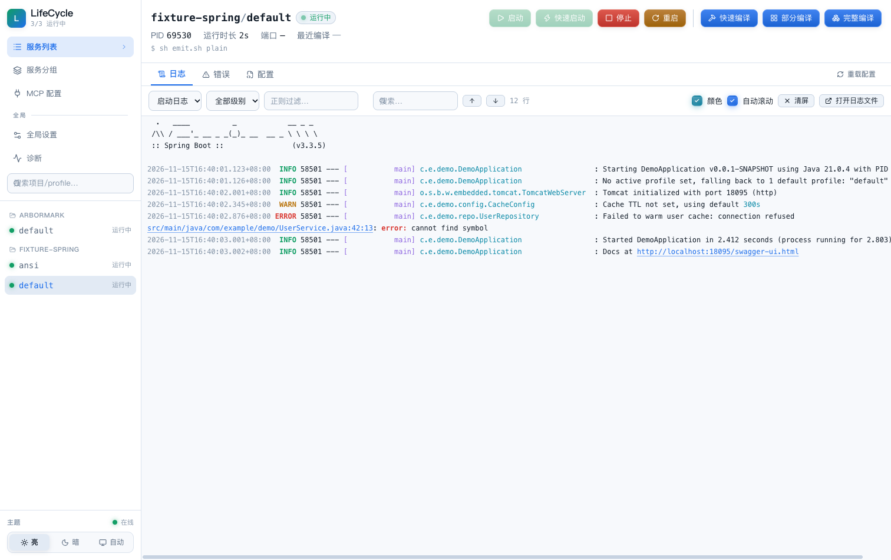
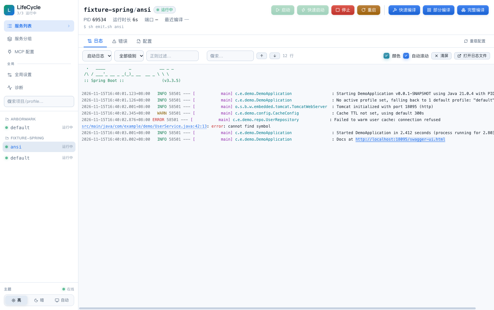
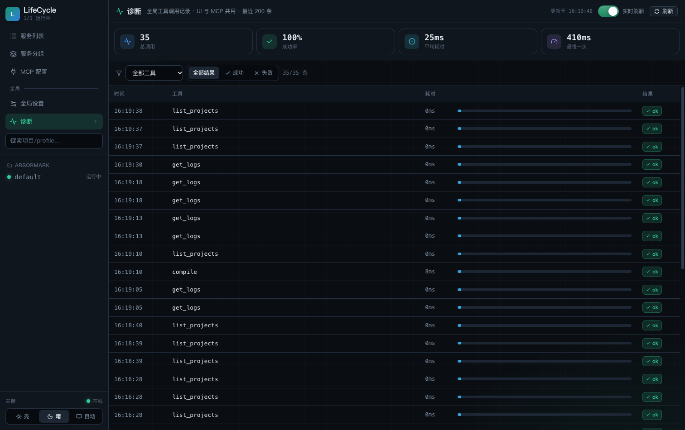

<p align="center">
  
</p>

<h1 align="center">LifeCycle</h1>

<p align="center">
  本地项目生命周期管理台 —— <b>一个有状态的 Core Engine，同时驱动桌面 UI、MCP Server 与 HTTP API</b>。
</p>

<p align="center">
  <a href="LICENSE"></a>
  
  
  
</p>

<p align="center">
  <a href="#快速开始">快速开始</a> ·
  <a href="#配置-lifecycletoml">配置参考</a> ·
  <a href="#mcp-接入">MCP 接入</a> ·
  <a href="#界面指南">界面指南</a> ·
  <a href="#截图">截图</a> ·
  <a href="#贡献指南">贡献</a>
</p>

启动 / 停止 / 重启、三档编译（quick / partial / full）、结构化错误、实时日志、服务分组一键启停、MCP 工具白名单——全部共享同一份进程与状态，不会出现"UI 看到的状态和 AI 看到的状态不一致"。

- 桌面端：Tauri 2 + React 19 + Tailwind CSS v4 + lucide-react（亮 / 暗 / 跟随系统三套主题）
- 后端：Rust workspace（core / cli / mcp / http / app）
- AI 接入：MCP stdio + Streamable HTTP，12 个工具，按项目配置暴露白名单
- 日志：ANSI 终端色 + Spring Boot 风格语义高亮，链接 ⌘/Ctrl+点击直达
- 无外部依赖：不需要数据库、不需要 Docker，状态落在项目内 `.lifecycle/` 与 `~/.lifecycle/`

---

## 目录

- [特性](#特性)
- [截图](#截图)
- [架构](#架构)
- [快速开始](#快速开始)
- [配置 lifecycle.toml](#配置-lifecycletoml)
- [创建服务与自动探测](#创建服务与自动探测)
- [服务分组](#服务分组)
- [界面指南](#界面指南)
- [MCP 接入](#mcp-接入)
- [HTTP API](#http-api)
- [CLI](#cli)
- [日志与编译](#日志与编译)
- [数据与文件位置](#数据与文件位置)
- [开发](#开发)
- [打包](#打包)
- [故障排查](#故障排查)
- [里程碑](#里程碑)
- [贡献指南](#贡献指南)
- [开源协议](#开源协议)

---

## 特性

**进程管理**
-  detached 进程组 spawn，stdout/stderr 全量落盘；停止时对整个进程组 `SIGTERM → 宽限 → SIGKILL`，不留孤儿（Windows 用 Job Object）。
-  就绪判定双通道：日志正则 `ready_pattern` **或** TCP 端口 `ready_port`（IPv4/IPv6 双栈探测，兼容只绑 `::1` 的 Vite）。
-  状态持久化，重启 App 后自动重新纳管活着的进程、清理死记录。
-  从 Finder / launchd 启动时自动补全工具链 PATH（nvm 最新 node、cargo、volta、homebrew），GUI 环境下也能找到 npm / cargo / mvn。

**编译**
-  三档语义：`quick`（增量）、`partial`（指定模块/目录）、`full`（清理全量）。
-  结构化 `BuildResult`：errors / warnings 带 `file:line:col`，点击直达编辑器。
-  解析器：maven/javac、gradle/kotlin、typescript/tsc、cargo/rust、go/generic；解析失败自动回退通用解析，不丢信息。
-  编译可取消；编译日志独立成文件，与运行日志分开看。

**控制台**
-  服务列表：状态 / PID / 运行时长 / 端口 / 最近编译，行内启停重启编译，多选批量操作，列排序 + 筛选 + 搜索（视图自动保存）。
-  服务分组：把微服务编成一组，一键启动 / 停止 / 重启整批，逐成员结果回显。
-  日志：虚拟列表（十万行不卡）、级别过滤、正则过滤、搜索跳转、自动滚动、SSE 实时流。
-  亮 / 暗 / 跟随系统主题，切换带柔和过渡；大号样式化勾选框与开关。

**AI / 自动化**
-  MCP 12 工具，stdio 与 Streamable HTTP 双传输。
-  按项目 `[mcp].expose` 白名单控制 AI 可见工具；`reload_config` 默认不暴露。
-  一键生成 / 写入 Claude Desktop、Cursor、VS Code、Codex CLI、Gemini CLI 的接入配置（保留原有内容、自动备份、可撤销）。
-  控制台内真实 MCP 握手"测试连接"，直接列出 AI 此刻能看到的工具。

---

## 截图

| 服务列表 · 亮色 | MCP 配置 · 暗色 |
| --- | --- |
|  |  |

| Spring 风格日志着色 · 暗色 | ANSI 终端色 · 亮色 | 全局诊断 · 暗色 |
| --- | --- | --- |
|  |  |  |

---

## 架构

```
                 ┌────────────────────────────────────────────┐
                 │              lifecycle-core                │
                 │  Engine（每项目一个，AsyncMutex 串行化）      │
                 │  process / logs / compile / config / groups │
                 │  Workspace（多项目 + 运行时注册 + 持久化）     │
                 └───────▲──────────────▲──────────────▲───────┘
                         │              │              │
        ┌────────────────┴───┐   ┌──────┴───────┐   ┌───┴──────────────┐
        │  lifecycle-app     │   │ lifecycle-mcp│   │  lifecycle-http  │
        │  Tauri 2 桌面端     │   │ rmcp stdio   │   │  axum REST + SSE │
        │  托盘 / 通知 / 孤儿  │   │ + HTTP /mcp  │   │  /mcp 挂载 MCP    │
        └─────────▲──────────┘   └──────▲───────┘   └───▲──────────────┘
                  │  ui/dist（React）    │  AI 客户端     │  浏览器 / Harness
                  └─────────────────────┴───────────────┘
```

| Crate | 职责 |
| --- | --- |
| `lifecycle-core` | 唯一状态持有者：配置解析、进程组、日志环形缓冲 + 落盘、编译与解析器、分组、注册表 |
| `lifecycle-cli` |  headless CLI：`list/start/stop/restart/status/compile/logs`，`--mcp` 切 stdio |
| `lifecycle-mcp` | rmcp Server：12 工具、expose 白名单、调用 Trace（stderr）、stdio + Streamable HTTP |
| `lifecycle-http` | axum：REST + SSE + `/healthz` + `/mcp`；分组编排；MCP 配置管理 API |
| `lifecycle-app` | Tauri 桌面壳：托盘、系统通知、孤儿清理、`--mcp-stdio` 复用为 MCP 入口 |
| `ui/` | React 19 + Vite + Tailwind v4 + lucide-react |

**关键约束**：UI 与 MCP 不各自持有状态，全部经由同一个 `Workspace` / `Engine`。命令只来自 `lifecycle.toml`，MCP 不接受任意 shell。

---

## 快速开始

依赖：Rust（stable）、Node ≥ 20、macOS / Windows / Linux。桌面端另需 Tauri 2 的系统依赖（macOS 自带 WKWebView）。

```bash
# 1. 构建后端
cargo build --release

# 2. 构建前端
npm --prefix ui install
npm --prefix ui run build

# 3a. 桌面端（开发）
cargo run -p lifecycle-app -- --scan ~/IdeaProjects

# 3b. 或 headless HTTP + MCP（浏览器打开 ui 的 dev server 即可）
cargo run -p lifecycle-http -- --scan ~/IdeaProjects --port 39517
npm --prefix ui run dev        # http://localhost:5173

# 3c. 或纯 CLI
cargo run -p lifecycle-cli -- -c path/to/lifecycle.toml list
```

首次启动没有任何项目也可以：在界面「创建服务」里填目录即可，注册会持久化，重启不丢。

---

## 配置 lifecycle.toml

放在项目根目录。一个文件描述一个项目的多个 profile（如 `default` / `worker`）。

```toml
[project]
name = "my-service"                 # 必填，全局唯一

[profiles.default]
workdir = "."                       # 相对项目根；命令的工作目录被限制在项目内
env = { RUST_LOG = "info" }         # 可选环境变量

[profiles.default.start]
command = "npm run dev"             # 必填；只从这里取命令，不接受外部 shell
ready_pattern = "Local:|ready in"   # 就绪正则（命中日志即就绪）
ready_port = 5173                   # 或 TCP 端口就绪（二者满足其一）
ready_timeout_ms = 120000           # 默认 120s

[profiles.default.compile.quick]    # 增量
command = "npm run build"
parser = "typescript"               # maven|gradle|typescript|cargo|go|generic
timeout_ms = 300000

[profiles.default.compile.partial]  # 部分编译；targets 由调用方传入
command = "mvn -pl {targets} compile"
parser = "maven"

[profiles.default.compile.full]     # 清理全量
command = "mvn clean compile"
parser = "maven"

[logs]
buffer_lines = 5000                 # 内存环形缓冲行数
dir = ".lifecycle/logs"             # 落盘目录
color = true                        # 强制子进程输出 ANSI 终端色（FORCE_COLOR 等）

[process]
stop_timeout_ms = 5000              # SIGTERM 后的宽限期，超时 SIGKILL 整组

[mcp]
transport = "stdio"                 # stdio | http | both（声明用途，见 MCP 章节）
expose = ["start_project", "stop_project", "compile_*"]   # 空 = 默认白名单
```

要点：
- `expose` 为空表示**默认白名单**＝除 `reload_config` 外全部；支持 `前缀*` 通配。
- `partial` 命令中的 `{targets}` 会被替换为逗号连接的目标列表。
- 改完配置在界面点「重载配置」或调 `reload_config`，无需重启进程管理。

---

## 创建服务与自动探测

界面「服务列表 → 创建服务」（快捷键 `n`）：

1. 填项目目录（必填），可选覆盖名称 / 就绪端口 / 启动命令。
2. 目录无 `lifecycle.toml` → 自动探测并生成：
   - `package.json` → Node/Web：优先 `web:dev` / `dev` / `start`；从 `vite.config.*`（含 `src/web`）读端口；编译取 `typecheck` 或 `build`。
   - `Cargo.toml` → `cargo run`，编译 `cargo build`。
   - `pom.xml` → Maven，编译 `mvn -q compile`。
3. 已有 `lifecycle.toml` → 直接导入。
4. 注册**热加载**进列表，并写入 `~/.lifecycle/projects.json`，重启后仍在。
   注册表只作用于控制台（桌面 / HTTP）；`lifecycle -c …`、`lifecycle-mcp -c …` 仍只加载显式传入的配置，保证单项目脚本语义不变。
5. 行内「卸载」＝停止进程 + 移除注册（二次确认，toast 可撤销）。

---

## 服务分组

「服务分组」页把任意多个 `project/profile` 编成一组（如"后端核心"＝注册中心 + 网关 + 用户服务）：

- 一键启动 / 停止 / 重启：组内成员**并行**执行（`join_all`），逐成员返回 ok/error 与状态。
- 卡片实时显示成员状态点与运行进度条；点成员 chip 直达详情。
- 删除分组可撤销（15s）。分组存于 `~/.lifecycle/groups.json`。

---

## 界面指南

| 区域 | 内容 |
| --- | --- |
| 侧栏 | 工作区：服务列表 / 服务分组 / MCP 配置；全局：全局设置 / 诊断；项目树 + 搜索；底部主题切换（亮 / 暗 / 自动）与后端在线状态 |
| 服务列表 | 顶部统计卡（运行中 / 启停中 / 崩溃 / 未启动 / 编译失败，点击即筛选）；表格吸顶表头、列排序、全选/半选、批量启停；行点击进详情 |
| 详情 | 状态卡 + 启动/快速启动/停止/重启 + 快速/部分/完整编译（编译中可取消）；页签仅含服务级内容：日志 / 错误 / 配置 |
| 日志 | 启动日志 / 编译日志切换；级别 + 正则过滤；搜索 + Enter/Shift+Enter 跳转；自动滚动；清屏；打开日志文件 |
| 错误 | 结构化诊断列表，点击跳编辑器行列；原始输出兜底展示 |
| 配置 | 展示 lifecycle.toml 全文，一键在编辑器打开 / 复制 |
| 全局设置 | 主题、系统通知开关、编辑器跳转命令（含 VS Code/Cursor/IntelliJ/Vim 预设）、日志缓冲与超时；脏标记保存栏 |
| 诊断 | 全局最近 200 次工具调用（UI 与 MCP 共用）：成功率/平均/最慢统计、按工具与结果筛选、耗时条形、实时刷新开关 |

快捷键：`/` 聚焦搜索，`n` 新建服务，`Esc` 关闭弹窗，日志搜索框 `Enter` / `Shift+Enter` 上下匹配。
筛选、排序、搜索与部分编译目标都会本地记住。

---

## MCP 接入

### 传输

- **stdio**：客户端拉起本地进程。可执行文件优先用同目录的 `lifecycle-mcp`；打包后的桌面 App 自身支持 `--mcp-stdio`，无需额外二进制。
- **Streamable HTTP**：`http://127.0.0.1:39517/mcp`（仅监听回环），复用常驻后端。

### 工具（12）

| 工具 | 作用 | 风险 |
| --- | --- | --- |
| `list_projects` | 列出项目与 profile 状态 | 只读 |
| `get_status` | 状态 / PID / 运行时长 / 最近编译 | 只读 |
| `get_logs` | 正则 + 游标增量读日志 | 只读 |
| `watch_logs` | 标记游标，之后只返回增量 | 只读 |
| `start_project` | 启动并等待就绪 | 进程 |
| `stop_project` | 进程组优雅停止 | 进程 |
| `restart_project` | 重启，可选先 quick 编译 | 进程 |
| `compile_quick` / `compile_partial` / `compile_full` | 三档编译，返回结构化结果 | 编译 |
| `cancel_compile` | 取消进行中的编译 | 编译 |
| `reload_config` | 重载 lifecycle.toml | 高危，**默认不暴露** |

### 白名单

在「MCP 配置」页按项目勾选（大号勾选框、按 查询/进程/编译/配置 分组、组级全选/半选），或直接用预设：

| 预设 | 含义 |
| --- | --- |
| 只读安全 | 只能查状态和日志 |
| 推荐（默认） | 启停 / 编译 / 日志全开，不含 reload_config |
| 只读 + 编译 | 允许 AI 编译修错，不允许动进程 |
| 全部 | 含 reload_config，谨慎 |

保存即写入该项目 `lifecycle.toml` 的 `[mcp]` 段（**其余内容与注释原样保留**），热生效；新的 MCP 会话立即按新白名单路由工具。
注意：空白名单会回退到默认策略，因此界面禁止保存"全不选"，避免"看起来全关其实全开"。

### 客户端接入

「MCP 配置 → 客户端接入」自动检测本机已安装的客户端，给出 stdio / HTTP 两种配置片段，可复制 / 下载 / 一键写入：

| 客户端 | 配置位置 | 顶层键 | 传输 |
| --- | --- | --- | --- |
| Claude Desktop | `~/Library/Application Support/Claude/claude_desktop_config.json`（Win: `%APPDATA%\Claude\…`） | `mcpServers` | stdio |
| Cursor | `~/.cursor/mcp.json` | `mcpServers` | stdio + HTTP |
| VS Code · Copilot | `…/Code/User/mcp.json` | `servers` | stdio + HTTP |
| Codex CLI | `~/.codex/config.toml` | `[mcp_servers.lifecycle]` | stdio |
| Gemini CLI | `~/.gemini/settings.json` | `mcpServers`（HTTP 用 `httpUrl`） | stdio + HTTP |
| Qoder | 应用内设置 → MCP | 粘贴片段 | stdio + HTTP |

写入是**合并**而非覆盖：只增删 `lifecycle` 这一个条目，其余服务器不动；写前自动备份为 `*.lifecycle-bak`，toast 提供「撤销」。
stdio 片段会注入当前 `PATH`，保证从 GUI 客户端拉起时能找到 node / npm / cargo。

### 测试连接

「测试连接」在浏览器里真实走一遍 MCP 握手（initialize → initialized → tools/list），显示服务端信息、协议版本、耗时，以及 **AI 此刻可见的工具列表**；若与当前白名单不一致会提示"已连接客户端需重开会话"。

### 安全边界

- 命令只来自 `lifecycle.toml`；MCP 工具不接受任意 shell 字符串。
- 工作目录限制在项目根内。
- `reload_config` 默认不暴露给 AI。
- HTTP 仅监听 `127.0.0.1`。
- 每次 MCP 调用向 stderr 输出 Trace（tool / input_hash / duration / exit_code），不污染 stdio 协议流。

---

## HTTP API

默认 `http://127.0.0.1:39517`。

| 方法 | 路径 | 说明 |
| --- | --- | --- |
| GET | `/healthz` | 存活探针 |
| GET | `/api/projects` | 全部项目 + profile 状态 |
| POST | `/api/projects/register` | 注册/导入服务（可自动生成 toml） |
| DELETE | `/api/projects/{project}` | 停止并卸载 |
| POST | `/api/projects/{project}/reload` | 重载配置 |
| GET | `/api/projects/{project}/config` | toml 路径 + 全文 |
| GET | `/api/projects/{project}/modules` | partial 编译候选模块 |
| GET/POST | `/api/projects/{project}/profiles/{profile}/status` `/start` `/stop` `/restart` | 状态与启停 |
| POST | `…/compile`、`…/compile/cancel` | 三档编译 / 取消 |
| GET | `…/logs`、`…/logs/stream` | 日志分页 / SSE 实时流 |
| GET | `/api/events` | 全局状态 SSE |
| GET/PUT | `/api/settings` | 设置（含 theme） |
| GET | `/api/diagnostics` | 最近工具调用 |
| POST | `/api/open-editor`、`/api/reveal-log` | 跳编辑器 / 定位日志文件 |
| POST | `/api/open-url` | 打开日志中的 http(s) 链接（校验 scheme、单 argv、拒绝注入） |
| GET/POST | `/api/groups` | 分组列表 / 新建 |
| PUT/DELETE | `/api/groups/{id}` | 更新 / 删除 |
| POST | `/api/groups/{id}/start|stop|restart` | 分组批量操作 |
| GET | `/api/mcp` | MCP 总览：端点、stdio 命令、工具目录、预设、各项目白名单、客户端配置 |
| PUT | `/api/mcp/projects/{project}` | 写 `[mcp]` 白名单并热生效 |
| POST | `/api/mcp/client-config` | 写入/移除客户端配置（合并 + 备份） |
| ANY | `/mcp` | MCP Streamable HTTP |

---

## CLI

```bash
lifecycle -c lifecycle.toml list
lifecycle -c lifecycle.toml start default            # 等待就绪
lifecycle -c lifecycle.toml start default --no-wait
lifecycle -c lifecycle.toml stop default
lifecycle -c lifecycle.toml restart default
lifecycle -c lifecycle.toml status default
lifecycle -c lifecycle.toml compile default -k partial -t mod-a,mod-b
lifecycle -c lifecycle.toml logs default --source build -n 200 --filter ERROR
lifecycle -c lifecycle.toml logs default -f          # 跟随
lifecycle -c lifecycle.toml --mcp                    # stdio MCP Server
```

headless 多项目：`lifecycle-http -c a.toml -c b.toml --port 39517` 或 `--scan <dir>`（两层深度自动发现）。

---

## 日志与编译

- 运行日志：`<project>/.lifecycle/logs/<profile>-run.log`
- 编译日志：`<project>/.lifecycle/logs/<profile>-build.log`（首行记录 `$ <command>`）
- 读取用**字节游标**增量返回；tail 只读尾部窗口，大文件不整读。
- 内存环形缓冲 `logs.buffer_lines` 行，供 SSE 与 MCP 快速取最近日志。
- 编译结果历史：`<project>/.lifecycle/builds.json`。

### 着色与链接

- **ANSI 终端色**：解析 SGR（16 / 256 / truecolor、粗体、淡体、下划线）与 OSC 8 超链接；亮暗主题各有一套调色板，过亮 / 过暗的颜色自动校正以保证对比度。
- **语义高亮**（无 ANSI 时）：Spring Boot 的时间戳 / 级别 / 线程 / logger、Vite banner、`npm notice/warn/error`、编译错误、耗时单位，按语义着色。
- **强制输出颜色**：`[logs].color = true`（默认）时 spawn 注入 `FORCE_COLOR` / `CLICOLOR_FORCE` / `CARGO_TERM_COLOR=always` / `SPRING_OUTPUT_ANSI_ENABLED=always`，管道日志也保留终端色；改完需重启服务生效。工具栏「颜色」开关只控制渲染，可即时对比。
- **可点击链接**：日志中的 `http(s)://…`、`localhost:port`、`file:line:col` 渲染为下划线链接，**⌘/Ctrl + 点击**打开默认浏览器（桌面端经 `/api/open-url`）或跳转编辑器对应行列。
- 长行不截断，日志区支持横向滚动；虚拟列表十万行不卡。
- 验证用 fixture：`fixtures/spring`（`default` 无 ANSI、`ansi` 带 SGR，模拟 Spring Boot 控制台）。

---

## 数据与文件位置

| 位置 | 内容 |
| --- | --- |
| `<project>/lifecycle.toml` | 项目配置（命令、就绪、编译、MCP 白名单） |
| `<project>/.lifecycle/state.json` | 进程状态持久化 |
| `<project>/.lifecycle/builds.json` | 编译历史 |
| `<project>/.lifecycle/logs/` | 运行 / 编译日志 |
| `~/.lifecycle/settings.json` | 全局设置（主题、通知、编辑器、超时） |
| `~/.lifecycle/groups.json` | 服务分组 |
| `~/.lifecycle/projects.json` | 已注册服务清单（重启不丢） |

---

## 开发

```bash
cargo test --workspace          # 单元 + 集成测试
cargo clippy --workspace --all-targets
bash scripts/fixtures-e2e.sh    # java/node/rust/simple 四个 fixture 端到端
node scripts/mcp-e2e.mjs        # MCP stdio 全工具端到端
npm --prefix ui run dev         # 前端热更新（需后端在 39517）
```

fixtures 端口：java 18091、node 18092、rust 18093、simple 18099；`fixtures/spring` 不占端口，用日志正则判定就绪，专门验证日志着色。

前端结构：`ui/src/App.jsx` 为壳与 SSE；`ui/src/lib/` 下按视图拆分组件；`app.css` 为双主题设计令牌（`--bg*`/`--line*`/`--txt`/`--acc-*` 等），组件不写死颜色。

---

## 打包

```bash
npm --prefix ui run build
npm --prefix ui run tauri -- build -f custom-protocol
# 或只构建可执行文件（不生成安装包）：
cargo build --release -p lifecycle-app --features custom-protocol
```

**必须带 `--features custom-protocol`**：否则 Tauri 走 `devUrl:5173`，打包产物会连到开发服务器而不是内嵌前端。
若改了 `ui/dist` 但产物没更新，先 `touch crates/lifecycle-app/tauri.conf.json crates/lifecycle-app/build.rs` 再构建（cargo 缓存不会自动重嵌前端）。

产物：`target/release/bundle/` 下的 `.app` / `.dmg`（macOS）或对应平台安装包。
打包后的 App 二进制自带 `--mcp-stdio`，可直接作为 Claude/Cursor 的 stdio 命令。

---

## 故障排查

| 现象 | 原因与处理 |
| --- | --- |
| 桌面端打开是别的页面 / 空白 | 用了 devUrl。按上面带 `--features custom-protocol` 重打包 |
| 改了前端但桌面端没变 | cargo 未重嵌 dist：touch `tauri.conf.json` 与 `build.rs` 后重构建 |
| 启动一直"启动中"最后超时 | 就绪条件不匹配：检查 `ready_pattern` 是否真会出现在日志，或改用 `ready_port` |
| Vite 项目端口探测失败 | Vite 可能只绑 `::1`；LifeCycle 已双栈探测，若仍失败请显式写 `ready_port` |
| `mvn -q compile` 日志很少 | `-q` 本身静默；想看细节去掉 `-q`，或看「编译日志」页签的完整输出 |
| 端口被占用 | 换 `--port`，或先停掉占用进程；LifeCycle 默认 39517 |
| 停止后仍有残留进程 | 正常不会（整组 SIGKILL）；若手动在 LifeCycle 外启动的进程不受管理 |
| GUI 启动后报 `npm: command not found` | 已自动补 nvm/cargo/homebrew PATH；若工具装在其它位置，在 `[profiles.*.env]` 里显式写 `PATH` |
| MCP 客户端看不到新工具 | 白名单在**新会话**生效；重开客户端会话，或用「测试连接」确认 |

---

## 里程碑

- **M0** 进程管理 CLI + 配置 + 日志 + 状态持久化 ✅
- **M1** 三档编译 + 结构化解析器 ✅
- **M2** MCP Server（stdio + 全工具 + Trace + 白名单）✅
- **M3** Tauri UI（状态卡 / 操作 / 日志 / 错误）✅
- **M4** 日志打磨（SSE / 虚拟列表 / 搜索 / 通知）✅
- **M5** HTTP + SSE + healthz + 多项目 ✅
- **M6** 托盘 / 设置 / 孤儿清理 / 打包 / fixtures ✅
- **增强** 服务列表 / 分组 / 创建服务 / React 迁移 / 亮暗主题 / MCP 配置台 / 注册持久化 ✅

---

## 贡献指南

欢迎 Issue 与 PR。

1. Fork 并新建分支：`feat/…` / `fix/…` / `docs/…`。
2. 提交前请通过：`cargo test --workspace`、`cargo clippy --workspace --all-targets`、`npm --prefix ui run build`；涉及进程/编译/MCP 的改动请跑 `scripts/fixtures-e2e.sh` 与 `scripts/mcp-e2e.mjs`。
3. 一个 PR 只做一件事；commit message 用 `feat(scope): …` / `fix(scope): …` / `docs: …` 形式。
4. UI 改动请附亮 / 暗两套主题截图；新增配置项请同步 README 配置参考与 `Config::validate`。
5. 安全相关（命令执行、URL 打开、MCP 暴露面）请在 PR 中说明威胁模型与校验方式。

代码风格：Rust 遵循 rustfmt 默认；前端组件放 `ui/src/lib/`，颜色一律走 `app.css` 设计令牌，不写死色值。

## 开源协议

[MIT](LICENSE) © 2026 LifeCycle contributors。

你可以自由使用、修改、分发与商用；保留版权与许可声明即可。软件按"原样"提供，不承担任何担保。