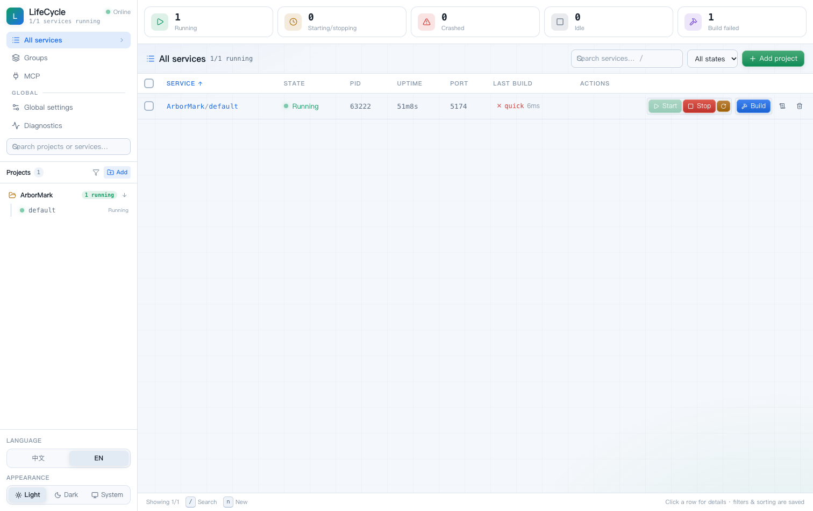
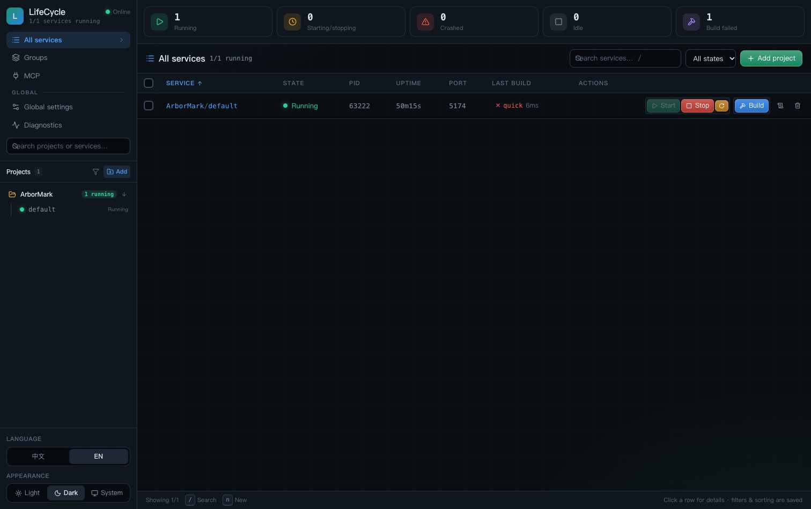
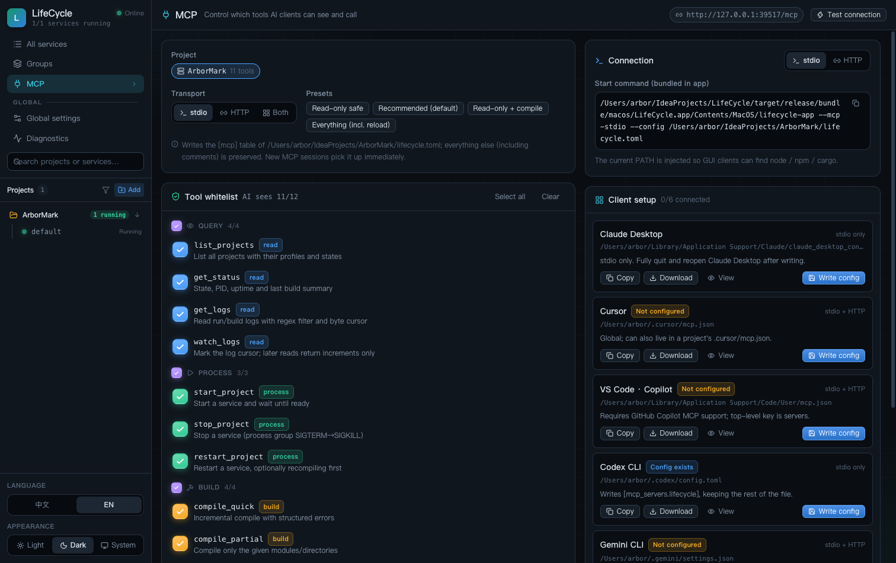
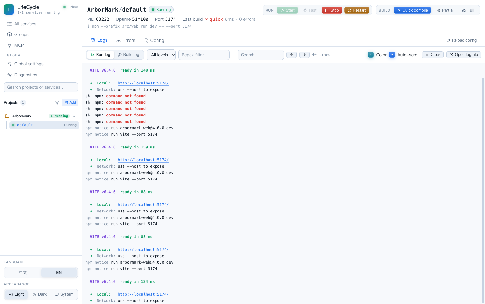
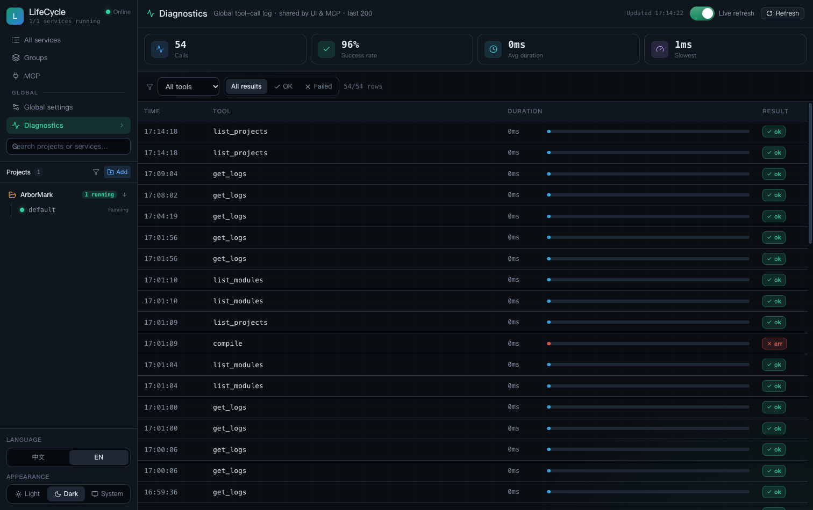

<p align="center">
  
</p>

<h1 align="center">LifeCycle</h1>

<p align="center">
  A local project lifecycle console — <b>one stateful Core Engine driving the desktop UI, the MCP server and the HTTP API</b>.
</p>

<p align="center">
  <a href="LICENSE"></a>
  
  
  
</p>

<p align="center">
  <b>English</b> · <a href="README.zh-CN.md">简体中文</a>
</p>

<p align="center">
  <a href="#quick-start">Quick start</a> ·
  <a href="#configuration-lifecycletoml">Configuration</a> ·
  <a href="#mcp-integration">MCP</a> ·
  <a href="#ui-guide">UI guide</a> ·
  <a href="#screenshots">Screenshots</a> ·
  <a href="#contributing">Contributing</a>
</p>

Start / stop / restart, three compile granularities (quick / partial / full), structured errors, live logs, one-click service groups, and an MCP tool whitelist — all sharing the same processes and state, so the UI and your AI assistant never disagree about what is running.

* Desktop: Tauri 2 + React 19 + Tailwind CSS v4 + lucide-react (light / dark / system themes)
* Backend: Rust workspace (core / cli / mcp / http / app)
* AI: MCP over stdio + Streamable HTTP, 22 tools, one global expose whitelist
* Logs: ANSI terminal colors + Spring-Boot-style semantic highlighting, ⌘/Ctrl-clickable links
* Bilingual UI: 中文 / English, switchable at runtime and persisted
* Zero external dependencies: no database, no Docker; state lives in `.lifecycle/` and `~/.lifecycle/`

***

## Contents

* [Features](#features)
* [Screenshots](#screenshots)
* [Architecture](#architecture)
* [Quick start](#quick-start)
* [Configuration (lifecycle.toml)](#configuration-lifecycletoml)
* [Adding services & auto-detection](#adding-services--auto-detection)
* [Service groups](#service-groups)
* [UI guide](#ui-guide)
* [MCP integration](#mcp-integration)
* [HTTP API](#http-api)
* [CLI](#cli)
* [Logs & compilation](#logs--compilation)
* [Data & file locations](#data--file-locations)
* [Development](#development)
* [Packaging](#packaging)
* [Troubleshooting](#troubleshooting)
* [Milestones](#milestones)
* [Contributing](#contributing)
* [License](#license)

***

## Features

**Process management**

* Detached process-group spawn; stdout/stderr fully persisted. Stopping signals the whole group `SIGTERM → grace → SIGKILL`, leaving no orphans (Job Objects on Windows).
* Dual readiness channels: log regex `ready_pattern` **or** TCP port `ready_port` (IPv4/IPv6 dual-stack probing, works with Vite bound only to `::1`).
* State survives restarts: live processes are re-adopted, dead records cleaned up.
* When launched from Finder / launchd, the toolchain PATH is completed automatically (latest nvm node, cargo, volta, homebrew) so npm / cargo / mvn are found in GUI contexts.

**Compilation**

* Three granularities: `quick` (incremental), `partial` (selected modules/dirs), `full` (clean build).
* Structured `BuildResult`: errors / warnings carry `file:line:col` and click through to your editor.
* Parsers: maven/javac, gradle/kotlin, typescript/tsc, cargo/rust, go/generic; falls back to a generic parser so nothing is lost.
* Compiles are cancellable; build logs are separate files from run logs.

**Console**

* Service list: state / PID / uptime / port / last build, inline start-stop-restart-compile, multi-select bulk actions, sortable columns + filters + search (view state is saved).
* Service groups: batch microservices and start / stop / restart them together, with per-member results.
* Logs: virtualized list (100k lines stay smooth), level + regex filters, search with jump-to-match, auto-scroll, live SSE stream.
* Light / dark / system themes with a soft cross-fade; large styled checkboxes and switches.
* Bilingual UI (中文 / English) with a runtime switcher, persisted to settings.

**AI / automation**

* 22 MCP tools over stdio and Streamable HTTP.
* One global whitelist (MCP page, stored in `~/.lifecycle/mcp.json`) controls what AI can see across all managed projects; `reload_config` is hidden by default.
* One-click generation / writing of client configs for Claude Desktop, Cursor, VS Code, Codex CLI and Gemini CLI (merge-preserving, auto-backup, undoable).
* A real in-console MCP handshake ("Test connection") lists exactly the tools AI can see right now.
* AI can create/configure projects and services (start command, compile commands, port) and control service groups via MCP.
* Every UI & MCP tool call is recorded with its **request and response**; open any record to inspect what was sent and what AI received.

***

## Screenshots

| Services · light                                          | Services · dark                                         |
| --------------------------------------------------------- | ------------------------------------------------------- |
|  |  |

| MCP configuration · dark                 | Colored logs · dark                        | Global diagnostics · dark                                |
| ---------------------------------------- | ------------------------------------------ | -------------------------------------------------------- |
|  |  |  |

Chinese UI screenshots live in [`docs/screenshots/zh/`](docs/screenshots/zh/) and are used by [README.zh-CN.md](README.zh-CN.md).

***

## Architecture

```
                 ┌────────────────────────────────────────────┐
                 │              lifecycle-core                │
                 │  Engine (one per project, AsyncMutex)      │
                 │  process / logs / compile / config / groups│
                 │  Workspace (multi-project + registry)      │
                 └───────▲──────────────▲──────────────▲──────┘
                         │              │              │
        ┌────────────────┴───┐   ┌──────┴───────┐   ┌───┴──────────────┐
        │  lifecycle-app     │   │ lifecycle-mcp│   │  lifecycle-http  │
        │  Tauri 2 desktop   │   │ rmcp stdio   │   │  axum REST + SSE │
        │  tray / notify     │   │ + HTTP /mcp  │   │  mounts /mcp     │
        └─────────▲──────────┘   └──────▲───────┘   └───▲──────────────┘
                  │  ui/dist (React)    │  AI clients   │  browser / harness
                  └─────────────────────┴───────────────┘
```

| Crate            | Responsibility                                                                                                        |
| ---------------- | --------------------------------------------------------------------------------------------------------------------- |
| `lifecycle-core` | The single state holder: config parsing, process groups, log ring buffer + files, compile & parsers, groups, registry |
| `lifecycle-cli`  | Headless CLI: `list/start/stop/restart/status/compile/logs`; `--mcp` switches to stdio                                |
| `lifecycle-mcp`  | rmcp server: 22 tools, expose whitelist, call traces (stderr), stdio + Streamable HTTP                                |
| `lifecycle-http` | axum: REST + SSE + `/healthz` + `/mcp`; group orchestration; MCP admin API                                            |
| `lifecycle-app`  | Tauri shell: tray, notifications, orphan cleanup; `--mcp-stdio` reuses the binary as an MCP entrypoint                |
| `ui/`            | React 19 + Vite + Tailwind v4 + lucide-react                                                                          |

**Key constraint**: the UI and MCP never hold separate state — everything goes through the same `Workspace` / `Engine`. Commands come only from `lifecycle.toml`; MCP accepts no arbitrary shell.

***

## Quick start

Requirements: Rust (stable), Node ≥ 20, macOS / Windows / Linux. The desktop app additionally needs Tauri 2 system dependencies (WKWebView is built into macOS).

```bash
# 1. Build the backend
cargo build --release

# 2. Build the frontend
npm --prefix ui install
npm --prefix ui run build

# 3a. Desktop (development)
cargo run -p lifecycle-app -- --scan ~/IdeaProjects

# 3b. Or headless HTTP + MCP (open the ui dev server in a browser)
cargo run -p lifecycle-http -- --scan ~/IdeaProjects --port 39517
npm --prefix ui run dev        # http://localhost:5173

# 3c. Or pure CLI
cargo run -p lifecycle-cli -- -c path/to/lifecycle.toml list
```

Starting with zero projects is fine: use **Add project** in the UI and point at a directory. Registrations persist across restarts.

***

## Configuration (lifecycle.toml)

Lives at the project root. One file describes several profiles of a project (e.g. `default` / `worker`).

```toml
[project]
name = "my-service"                 # required, globally unique

[profiles.default]
workdir = "."                       # relative to project root; cwd is confined to the project
env = { RUST_LOG = "info" }         # optional environment

[profiles.default.start]
command = "npm run dev"             # required; the only source of commands
ready_pattern = "Local:|ready in"   # readiness regex (matched against logs)
ready_port = 5173                   # or TCP readiness (either channel suffices)
ready_timeout_ms = 120000           # default 120s

[profiles.default.compile.quick]    # incremental
command = "npm run build"
parser = "typescript"               # maven|gradle|typescript|cargo|go|generic
timeout_ms = 300000

[profiles.default.compile.partial]  # partial; targets supplied by the caller
command = "mvn -pl {targets} compile"
parser = "maven"

[profiles.default.compile.full]     # clean full build
command = "mvn clean compile"
parser = "maven"

[logs]
buffer_lines = 5000                 # in-memory ring buffer lines
dir = ".lifecycle/logs"             # on-disk directory
color = true                        # force ANSI output in children (FORCE_COLOR etc.)

[process]
stop_timeout_ms = 5000              # grace after SIGTERM, then SIGKILL the group
```

Notes:

* The MCP whitelist is **global** — manage it on the MCP page. An empty selection falls back to the default policy (everything except `reload_config`); `prefix*` wildcards are supported.
* `{targets}` in a `partial` command is replaced with the comma-joined target list.
* After editing, click **Reload config** in the UI (or call `reload_config`) for an immediate refresh. Edits written by other processes (an editor, a separate stdio MCP server) are hot-reloaded automatically within ~2s — including registry additions/removals in `~/.lifecycle/projects.json` — and the UI updates live over SSE.

***

## Adding services & auto-detection

UI: **Services → Add service** (shortcut `n`) for service-level registration, or **Projects → Add** in the sidebar for project-level import. The dialog title follows the entry point ("Add / import service" vs "Add / import project"):

1. Type a project directory (required) or click **Choose folder…** to use the native OS directory picker. While typing, the stack is probed live and previewed (kind / default start command / default port). Optionally override name / ready port / start command.
2. No `lifecycle.toml` in the directory → detect and generate:
   * `package.json` → Node/Web: prefers `web:dev` / `dev` / `start`; port read from `vite.config.*` (incl. `src/web`); compile uses `typecheck` or `build`.
   * `Cargo.toml` → `cargo run`, compile `cargo build`.
   * `pom.xml` → Maven, compile `mvn -q compile`.
3. Existing `lifecycle.toml` → imported as-is.
4. Registration is **hot-loaded** into the list and written to `~/.lifecycle/projects.json`, so it survives restarts.
   The registry only affects the console (desktop / HTTP); `lifecycle -c …` and `lifecycle-mcp -c …` still load exactly the configs you pass, keeping single-project script semantics.
5. Inline **Unregister** = stop processes + remove registration (two-click confirm, undoable via toast).

***

## Service groups

The **Groups** page batches any number of `project/profile` pairs (e.g. "backend core" = registry + gateway + user service):

* One-click start / stop / restart: members run **in parallel** (`join_all`), each returning ok/error and state.
* Cards show live member dots and a running-progress bar; clicking a member chip opens its detail.
* Group deletion is undoable (15s). Groups live in `~/.lifecycle/groups.json`.

***

## UI guide

| Area            | Contents                                                                                                                                                                                                                                      |
| --------------- | --------------------------------------------------------------------------------------------------------------------------------------------------------------------------------------------------------------------------------------------- |
| Sidebar         | Three entries: Services / Groups / MCP. Footer: a Settings button, a single theme-cycle button (light → dark → system) and a collapse control that shrinks the sidebar to an icon rail. Language lives in Settings                            |
| Services        | Stat tiles (running / starting-stopping / crashed / idle / build failed — click to filter); sticky header, sortable columns, select-all with indeterminate state, bulk start/stop; row click opens detail                                     |
| Detail          | Status card + start / fast-start / stop / restart + quick / partial / full compile (cancellable while running); tabs are service-scoped only: Logs / Errors / Config                                                                          |
| Logs            | Run-log / build-log toggle; level + regex filters; search with Enter / Shift+Enter jump; auto-scroll; clear screen (display only); clear logs (truncates on-disk files, scope-confirm modal); open log file; color toggle                     |
| Errors          | Structured diagnostics, click to jump to editor line/col; raw output as fallback                                                                                                                                                              |
| Config          | Structured command form + raw lifecycle.toml editor (validate-before-write, hot reload, Ctrl/⌘+S); open-in-editor / copy                                                                                                                      |
| Global settings | Language, theme, notification switch, editor jump command (VS Code/Cursor/IntelliJ/Vim presets), log buffer & timeouts; dirty-state save bar                                                                                                  |
| MCP → Call log  | Global last-200 tool calls (shared by UI & MCP): success-rate / avg / live MCP-connection stats, filter by source and result, duration bars, live-refresh toggle; clicking a row opens a detail dialog with the full request & response JSON (copyable) |

Shortcuts: `/` focus search, `n` add project, `Esc` close dialogs, `Enter` / `Shift+Enter` next/previous log match.
Filters, sorting, search and partial-compile targets are remembered locally.

***

## MCP integration

### Transports

* **stdio**: the client spawns a local process. Prefers a sibling `lifecycle-mcp` binary; the packaged desktop app itself supports `--mcp-stdio`, so no extra binary is needed.
* **Streamable HTTP**: `http://127.0.0.1:39517/mcp` (loopback only), reusing the running backend.

### Tools (22)

| Tool                                                             | Purpose                                                                                                                         | Risk                          |
| ---------------------------------------------------------------- | ------------------------------------------------------------------------------------------------------------------------------- | ----------------------------- |
| `list_projects`                                                  | List projects and profile states                                                                                                | read                          |
| `get_status`                                                     | State / PID / uptime / last build                                                                                               | read                          |
| `get_logs`                                                       | Regex + cursor-incremental log reads                                                                                            | read                          |
| `watch_logs`                                                     | Mark a cursor; later reads return increments only                                                                               | read                          |
| `start_project`                                                  | Start and wait until ready                                                                                                      | process                       |
| `stop_project`                                                   | Graceful process-group stop                                                                                                     | process                       |
| `restart_project`                                                | Restart, optionally recompiling first                                                                                           | process                       |
| `compile_quick` / `compile_partial` / `compile_full`             | Three compile granularities, structured results                                                                                 | build                         |
| `compile_package`                                                | Package distributable artifacts (app bundle / dist) via `compile.package`; output streams live to the build log                 | build                         |
| `cancel_compile`                                                 | Cancel an in-progress compile                                                                                                   | build                         |
| `reload_config`                                                  | Reload lifecycle.toml                                                                                                           | danger, **hidden by default** |
| `register_project`                                               | Register/import a project: detect stack, generate lifecycle.toml, hot-load                                                      | config                        |
| `configure_service`                                              | Configure a profile (creates it if absent): start/fast/stop/restart commands, ready port/pattern/timeout, workdir, env, quick/partial/full/package compile; empty string clears optional fields | config                        |
| `list_groups` / `create_group` / `update_group` / `delete_group` | Manage service groups                                                                                                           | read / control                |
| `start_group` / `stop_group` / `restart_group`                   | One-click batch lifecycle for a group, per-member results                                                                       | control                       |

### Whitelist

On the **MCP** page, tick tools (large checkboxes, grouped by query/process/build/config, group-level select-all with indeterminate state), or apply a preset:

| Preset                | Meaning                                              |
| --------------------- | ---------------------------------------------------- |
| Read-only safe        | Status and logs only                                 |
| Recommended (default) | Start/stop, compile and logs; excludes reload_config |
| Read-only + compile   | Let AI compile and fix errors, never touch processes |
| Everything            | Includes reload_config — use with care               |

Saving writes LifeCycle's own `~/.lifecycle/mcp.json` — one whitelist for the whole tool, applied to every managed project — and takes effect hot; new MCP sessions route tools by it. Legacy `[mcp]` sections in managed projects' `lifecycle.toml` are parsed but ignored.
Note: an empty whitelist falls back to the default policy, so the UI refuses to save "nothing selected" — avoiding "looks off, actually on".

### Client setup

**MCP → Client setup** detects installed clients and offers stdio / HTTP snippets to copy / download / write:

| Client            | Config location                                                                               | Top-level key                     | Transport    |
| ----------------- | --------------------------------------------------------------------------------------------- | --------------------------------- | ------------ |
| Claude Desktop    | `~/Library/Application Support/Claude/claude_desktop_config.json` (Win: `%APPDATA%\Claude\…`) | `mcpServers`                      | stdio        |
| Cursor            | `~/.cursor/mcp.json`                                                                          | `mcpServers`                      | stdio + HTTP |
| VS Code · Copilot | `…/Code/User/mcp.json`                                                                        | `servers`                         | stdio + HTTP |
| Codex CLI         | `~/.codex/config.toml`                                                                        | `[mcp_servers.lifecycle]`         | stdio        |
| Gemini CLI        | `~/.gemini/settings.json`                                                                     | `mcpServers` (`httpUrl` for HTTP) | stdio + HTTP |
| Qoder             | In-app Settings → MCP                                                                         | paste the snippet                 | stdio + HTTP |

Writing **merges** rather than overwrites: only the `lifecycle` entry is added/removed, other servers untouched; a `*.lifecycle-bak` backup is created first and the toast offers **Undo**.
stdio snippets inject the current `PATH` so GUI-launched clients find node / npm / cargo.

### Test connection

"Test connection" performs a real MCP handshake in the browser (initialize → initialized → tools/list) and shows server info, protocol version, latency and **the exact tool list AI can see now**; a mismatch with the current whitelist warns that connected clients need a new session.

### Security boundaries

* Commands come only from `lifecycle.toml`; MCP tools accept no arbitrary shell strings.
* Working directories are confined to the project root.
* `reload_config` is not exposed to AI by default.
* HTTP listens on `127.0.0.1` only.
* Every MCP call emits a trace to stderr (tool / input_hash / duration / exit_code) without polluting the stdio protocol stream.

***

## HTTP API

Default `http://127.0.0.1:39517`.

| Method     | Path                                                                            | Description                                                                                          |           |                        |
| ---------- | ------------------------------------------------------------------------------- | ---------------------------------------------------------------------------------------------------- | :-------- | :--------------------- |
| GET        | `/healthz`                                                                      | Liveness probe                                                                                       |           |                        |
| GET        | `/api/projects`                                                                 | All projects + profile states                                                                        |           |                        |
| POST       | `/api/projects/register`                                                        | Register/import a service (may generate toml)                                                        |           |                        |
| POST       | `/api/projects/{project}/profiles`                                              | Add a service (profile) inside an existing project                                                   |           |                        |
| POST       | `/api/projects/choose-directory`                                                | Native OS folder picker                                                                              |           |                        |
| POST       | `/api/projects/detect`                                                          | Probe a directory (stack / command / port / existing toml)                                           |           |                        |
| DELETE     | `/api/projects/{project}`                                                       | Stop and unregister                                                                                  |           |                        |
| POST       | `/api/projects/{project}/reload`                                                | Reload config                                                                                        |           |                        |
| GET        | `/api/projects/{project}/config`                                                | toml path + content                                                                                  |           |                        |
| GET        | `/api/projects/{project}/modules`                                               | Candidate modules for partial compile                                                                |           |                        |
| GET/POST   | `/api/projects/{project}/profiles/{profile}/status` `/start` `/stop` `/restart` | State & lifecycle                                                                                    |           |                        |
| POST       | `…/compile`, `…/compile/cancel`                                                 | Three compile granularities / cancel                                                                 |           |                        |
| GET        | `…/logs`, `…/logs/stream`                                                       | Log page / SSE live stream                                                                           |           |                        |
| GET        | `/api/events`                                                                   | Global state SSE                                                                                     |           |                        |
| GET/PUT    | `/api/settings`                                                                 | Settings (theme, language, …)                                                                        |           |                        |
| GET        | `/api/diagnostics`                                                              | Recent tool calls with request/response payloads                                                     |           |                        |
| POST       | `/api/open-editor`, `/api/reveal-log`                                           | Jump to editor / reveal log file                                                                     |           |                        |
| POST       | `/api/open-url`                                                                 | Open an http(s) link from logs (scheme-validated, single argv, injection-rejecting)                  |           |                        |
| GET/POST   | `/api/groups`                                                                   | List / create groups                                                                                 |           |                        |
| PUT/DELETE | `/api/groups/{id}`                                                              | Update / delete                                                                                      |           |                        |
| POST       | \`/api/groups/{id}/start                                                        | stop                                                                                                 | restart\` | Group batch operations |
| GET        | `/api/mcp`                                                                      | MCP overview: endpoint, stdio command, tool catalog, presets, global whitelist, client configs        |           |                        |
| GET        | `/api/mcp/connections`                                                          | Live MCP connections: active HTTP sessions + local stdio server processes                             |           |                        |
| PUT        | `/api/mcp/whitelist`                                                            | Write the global whitelist, hot-apply                                                                 |           |                        |
| POST       | `/api/mcp/client-config`                                                        | Write/remove client config (merge + backup)                                                          |           |                        |
| ANY        | `/mcp`                                                                          | MCP Streamable HTTP                                                                                  |           |                        |

***

## CLI

```bash
lifecycle -c lifecycle.toml list
lifecycle -c lifecycle.toml start default            # waits for readiness
lifecycle -c lifecycle.toml start default --no-wait
lifecycle -c lifecycle.toml stop default
lifecycle -c lifecycle.toml restart default
lifecycle -c lifecycle.toml status default
lifecycle -c lifecycle.toml compile default -k partial -t mod-a,mod-b
lifecycle -c lifecycle.toml logs default --source build -n 200 --filter ERROR
lifecycle -c lifecycle.toml logs default -f          # follow
lifecycle -c lifecycle.toml --mcp                    # stdio MCP server
```

Headless multi-project: `lifecycle-http -c a.toml -c b.toml --port 39517` or `--scan <dir>` (two-level auto-discovery).

***

## Logs & compilation

* Run log: `<project>/.lifecycle/logs/<profile>-run.log`
* Build log: `<project>/.lifecycle/logs/<profile>-build.log` (first line records `$ <command>`)
* Reads are **byte-cursor** incremental; tail only reads the trailing window, never whole large files.
* An in-memory ring buffer of `logs.buffer_lines` lines feeds SSE and MCP quickly.
* Build history: `<project>/.lifecycle/builds.json`.

### Coloring & links

* **ANSI terminal colors**: SGR (16 / 256 / truecolor, bold, dim, underline) and OSC 8 hyperlinks are parsed; light and dark themes each have a palette, and too-bright / too-dark colors are auto-corrected for contrast.
* **Semantic highlighting** (when no ANSI): Spring Boot timestamp / level / thread / logger, Vite banner, `npm notice/warn/error`, compile errors and duration units are colored by meaning.
* **Forced color output**: with `[logs].color = true` (default), spawn injects `FORCE_COLOR` / `CLICOLOR_FORCE` / `CARGO_TERM_COLOR=always` / `SPRING_OUTPUT_ANSI_ENABLED=always`, so piped logs keep terminal colors; restart the service after changing it. The toolbar **Color** switch only controls rendering, for instant comparison.
* **Clickable links**: `http(s)://…`, `localhost:port` and `file:line:col` in logs render as underlined links; **⌘/Ctrl + click** opens the default browser (via `/api/open-url` on desktop) or jumps to the editor line/col.
* Long lines are not truncated; the log area scrolls horizontally; the virtualized list stays smooth at 100k lines.
* Verification fixture: `fixtures/spring` (`default` without ANSI, `ansi` with SGR, emulating a Spring Boot console).

***

## Data & file locations

| Location                           | Contents                                                           |
| ---------------------------------- | ------------------------------------------------------------------ |
| `<project>/lifecycle.toml`         | Project config (commands, readiness, compile, MCP whitelist)       |
| `<project>/.lifecycle/state.json`  | Persisted process state                                            |
| `<project>/.lifecycle/builds.json` | Build history                                                      |
| `<project>/.lifecycle/logs/`       | Run / build logs                                                   |
| `~/.lifecycle/settings.json`       | Global settings (theme, language, notifications, editor, timeouts) |
| `~/.lifecycle/groups.json`         | Service groups                                                     |
| `~/.lifecycle/mcp.json`            | Global MCP whitelist + transport preference                        |
| `~/.lifecycle/projects.json`       | Registered services (survive restarts)                             |

***

## Development

```bash
cargo test --workspace          # unit + integration tests
cargo clippy --workspace --all-targets
bash scripts/fixtures-e2e.sh    # java/node/rust/simple fixtures end-to-end
node scripts/mcp-e2e.mjs        # MCP stdio all-tools end-to-end
node scripts/mcp-admin-e2e.mjs  # MCP register/configure/group tools end-to-end
node scripts/http-add-service-e2e.mjs  # add-service API: create/validate/start/cleanup
node scripts/http-clear-logs-e2e.mjs  # clear-logs API: truncate/keep-appending/scope validation
node scripts/http-raw-config-e2e.mjs  # raw config save: hot reload / invalid TOML / workdir confinement
node scripts/http-mcp-connections-e2e.mjs  # live MCP connections: stdio process / HTTP session deltas
node scripts/http-config-watch-e2e.mjs  # external toml/registry edits: hot reload + SSE push + stdio session sync
npm --prefix ui run dev         # frontend HMR (backend on 39517)
```

Fixture ports: java 18091, node 18092, rust 18093, simple 18099; `fixtures/spring` uses no port (readiness via log regex) and exists to verify log coloring.

Frontend layout: `ui/src/App.jsx` is the shell + SSE; views live in `ui/src/lib/`; `app.css` holds the dual-theme design tokens (`--bg*` / `--line*` / `--txt` / `--acc-*`); components never hardcode colors. UI copy goes through `ui/src/lib/i18n.js` (Chinese source keys → English map).

***

## Packaging

```bash
npm --prefix ui run build
npm --prefix ui run tauri -- build -f custom-protocol
# or build only the executable (no installer):
cargo build --release -p lifecycle-app --features custom-protocol
```

**`--features custom-protocol` is required**: otherwise Tauri uses `devUrl:5173` and the bundle would talk to a dev server instead of the embedded frontend.
If you changed `ui/dist` but the bundle didn't update, `touch crates/lifecycle-app/tauri.conf.json crates/lifecycle-app/build.rs` first (cargo does not re-embed the frontend automatically).

App icons are generated from the same mark as `docs/logo.svg` and the sidebar logo: `node scripts/gen-icons.mjs` (headless Chrome transparent rasterization + sips + iconutil; corners stay alpha-transparent, multi-size PNG `.ico`, monochrome tray template).

Artifacts: `.app` / `.dmg` under `target/release/bundle/` (macOS) or the platform installer.
The packaged app binary supports `--mcp-stdio`, so it can be used directly as the stdio command for Claude/Cursor.

***

## Troubleshooting

| Symptom                                   | Cause & fix                                                                                       |
| ----------------------------------------- | ------------------------------------------------------------------------------------------------- |
| Desktop shows another page / blank        | devUrl was used. Rebuild with `--features custom-protocol` as above                               |
| Frontend changed but desktop didn't       | cargo didn't re-embed dist: touch `tauri.conf.json` and `build.rs`, rebuild                       |
| Stuck "starting" then timeout             | Readiness mismatch: check `ready_pattern` actually appears in logs, or use `ready_port`           |
| Vite port probe fails                     | Vite may bind only `::1`; LifeCycle probes dual-stack, but set `ready_port` explicitly if needed  |
| `mvn -q compile` logs look empty          | `-q` is silent by design; drop `-q` or read the full output in the build-log tab                  |
| Port already in use                       | Change `--port` or stop the occupant; LifeCycle defaults to 39517                                 |
| Leftover processes after stop             | Should not happen (whole-group SIGKILL); processes started outside LifeCycle are unmanaged        |
| `npm: command not found` after GUI launch | PATH is auto-completed (nvm/cargo/homebrew); for other locations set `PATH` in `[profiles.*.env]` |
| MCP client doesn't see new tools          | Whitelists apply to **new sessions**; reopen the client session or use "Test connection"          |

***

## Milestones

* **M0** Process CLI + config + logs + state persistence ✅
* **M1** Three compile granularities + structured parsers ✅
* **M2** MCP server (stdio + all tools + traces + whitelist) ✅
* **M3** Tauri UI (status card / actions / logs / errors) ✅
* **M4** Log polish (SSE / virtual list / search / notifications) ✅
* **M5** HTTP + SSE + healthz + multi-project ✅
* **M6** Tray / settings / orphan cleanup / packaging / fixtures ✅
* **Enhancements** Service list / groups / add-service / React migration / themes / MCP console / persistent registry / log coloring / bilingual UI ✅

***

## Contributing

Issues and PRs welcome.

1. Fork and branch: `feat/…` / `fix/…` / `docs/…`.
2. Before submitting, pass: `cargo test --workspace`, `cargo clippy --workspace --all-targets`, `npm --prefix ui run build`; for process/compile/MCP changes also run `scripts/fixtures-e2e.sh` and `scripts/mcp-e2e.mjs`.
3. One concern per PR; commit messages follow `feat(scope): …` / `fix(scope): …` / `docs: …`.
4. UI changes: attach light **and** dark screenshots, in both languages if copy changed; new config keys must update the configuration reference and `Config::validate`.
5. Security-relevant changes (command execution, URL opening, MCP expose surface): describe the threat model and validation in the PR.

Style: Rust follows rustfmt defaults; frontend components live in `ui/src/lib/`; colors always come from `app.css` design tokens; user-facing strings go through `i18n.js` (add both zh and en).

## License

[MIT](LICENSE) © 2026 LifeCycle contributors.

Free to use, modify, distribute and sell; keep the copyright and license notice. The software is provided "as is", without warranty of any kind.
